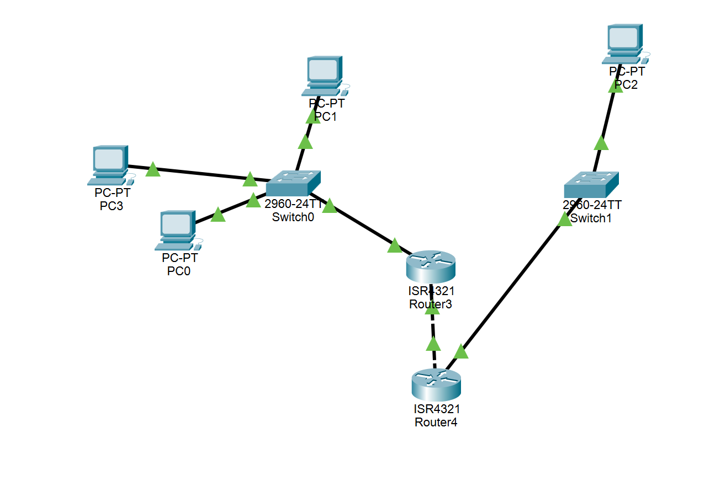
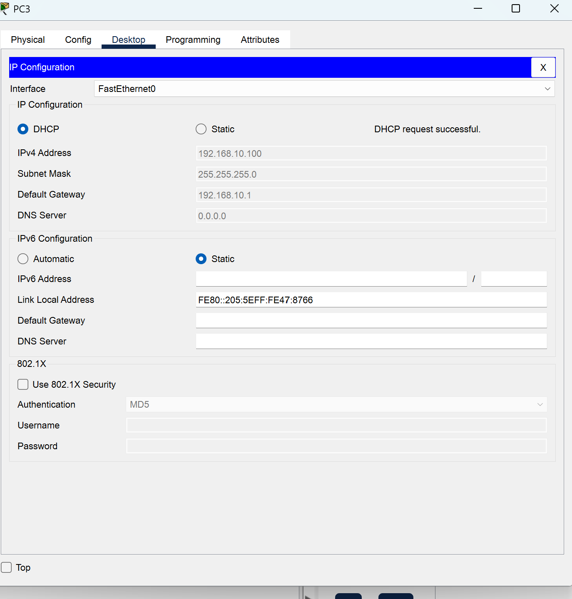
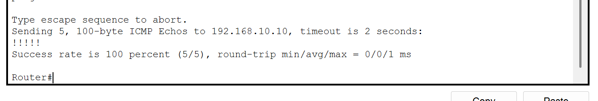
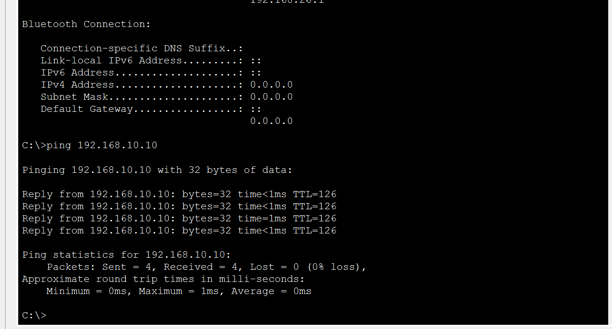
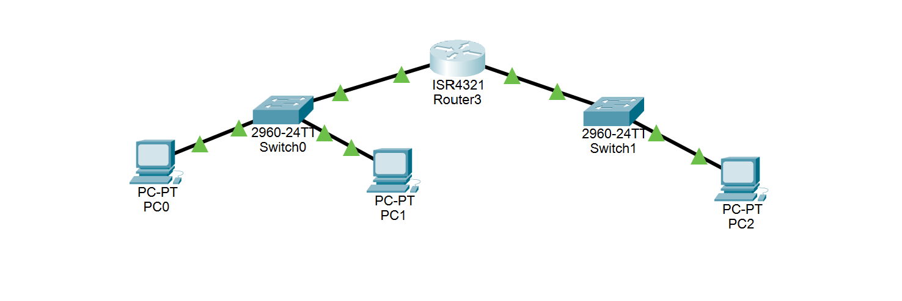
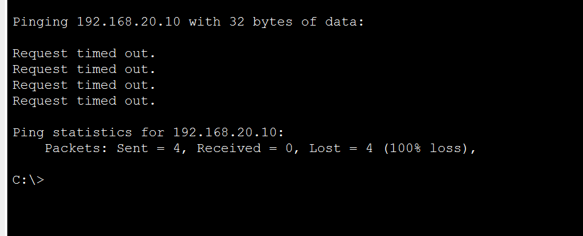
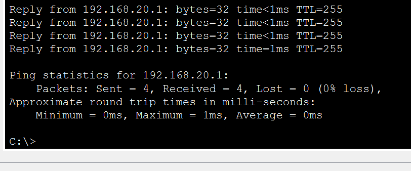
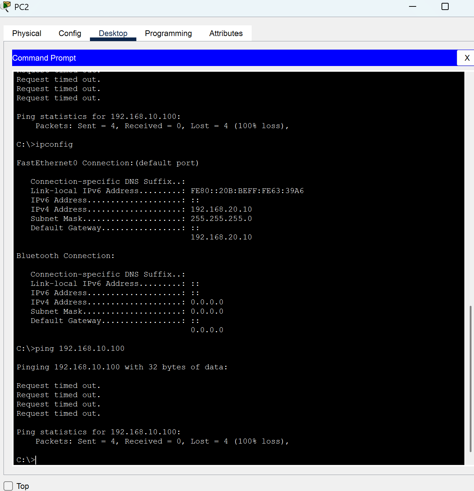

# Network Operations Lab — Cisco Packet Tracer

A hands-on networking lab for entry-level NOC troubleshooting. The final simulation connects two LANs through two ISR4321 routers, with static routing and DHCP on the left LAN. The repository also documents a deliberately introduced default-gateway fault and its diagnosis.

## Final topology



PC0, PC1, and PC3 connect to Switch0 and Router3 on `192.168.10.0/24`. Router3 and Router4 use a dedicated `192.168.30.0/30` link. Router4 connects to Switch1 and PC2 on `192.168.20.0/24`. There are no VLANs, trunk links, or third switch in the final topology.

| Device / interface | Address | Purpose |
| --- | --- | --- |
| Router3 Gi0/0/0 | `192.168.10.1/24` | Left-LAN gateway and DHCP server |
| PC0 | `192.168.10.10/24`; gateway `192.168.10.1` | Static client |
| PC1 | `192.168.10.20/24`; gateway `192.168.10.1` | Static client |
| PC3 | `192.168.10.100/24`; gateway `192.168.10.1` | DHCP lease observed |
| Router3 Gi0/0/1 | `192.168.30.1/30` | Link to Router4 |
| Router4 Gi0/0/1 | `192.168.30.2/30` | Link to Router3 |
| Router4 Gi0/0/0 | `192.168.20.1/24` | Right-LAN gateway |
| PC2 | `192.168.20.10/24`; gateway `192.168.20.1` | Static client |

The routers need explicit routes because each knows only its directly attached networks. The final configuration uses:

```text
Router3: ip route 192.168.20.0 255.255.255.0 192.168.30.2
Router4: ip route 192.168.10.0 255.255.255.0 192.168.30.1
```

The transit link uses `/30` (`255.255.255.252`); the two client LANs use `/24` (`255.255.255.0`).

## DHCP and checks

Router3 supplies addresses on `192.168.10.0/24`, advertises `192.168.10.1` as the gateway, and excludes `192.168.10.1`–`192.168.10.99`. PC3 received `192.168.10.100` in the observed test. DNS was not configured, so the displayed DNS address was `0.0.0.0`.



| Check | Observed result |
| --- | --- |
| Router4 ping to Router3 `192.168.30.1` | 4/5 replies during first test; the first probe was lost during address resolution |
| Router4 ping to PC0 `192.168.10.10` after route correction | 5/5 replies |
| PC2 ping to PC0 `192.168.10.10` | 4/4 replies, 0% loss in the final two-router topology |
| Router3 and Router4 running configuration saved | Both returned `[OK]` after `copy running-config startup-config` |





## Troubleshooting case: wrong gateway on PC2

This incident occurred in the **earlier, single-router version** of the lab. The network was expanded to two routers afterward; the fault is retained here as a separate troubleshooting exercise.



1. **Symptom:** PC3's ping to PC2 timed out on all four probes after PC2's gateway was deliberately changed away from `192.168.20.1`.
2. **Isolation:** PC3 could reach the right-hand gateway address `192.168.20.1`, but PC2 could not return traffic correctly.
3. **Evidence:** `ipconfig` on PC2 showed `192.168.20.10` as its gateway after an attempted correction; that was PC2's own address, not the router's.
4. **Fix:** Restore PC2's gateway to `192.168.20.1` and repeat the cross-LAN ping.





An additional earlier baseline ping is available in [screenshots/routing-baseline.png](screenshots/routing-baseline.png). The incident images document the historical test, not the final two-router wiring.

## Run the simulation

Open [network-operations-lab.pkt](network-operations-lab.pkt) in Cisco Packet Tracer. From PC2, open **Desktop → Command Prompt** and run `ping 192.168.10.10`. To inspect routing, run `show ip route` in each router's CLI. For the DHCP example, inspect PC3 under **Desktop → IP Configuration**.

This is a Packet Tracer learning lab. It does not implement live monitoring, alerting, NAT, OSPF, VLANs, or internet access.
